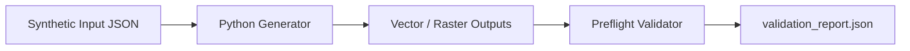
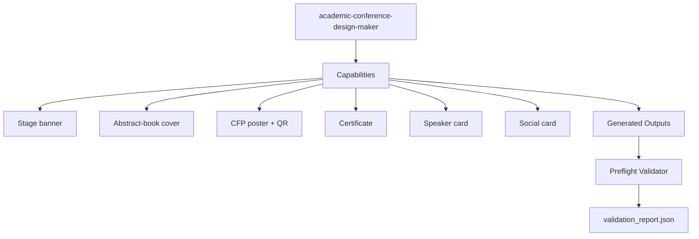

# `academic-conference-design-maker`

Portable Agent Skill for **Claude Code** and **Cline** that builds a coordinated 6-asset academic conference visual identity kit (`banner`, `abstract_book_cover`, `event_poster`, `certificate`, `speaker_card`, `social_card`, and `kit_overview.png`).

## Workflow

## Skill Aspects

