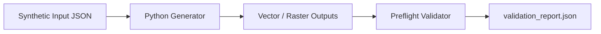

# `clinical-trial-visualizer`

Portable Agent Skill for **Claude Code** and **Cline** that produces EQUATOR/CONSORT-compliant clinical trial participant flow diagrams, SPIRIT protocol timelines, endpoint summary panels, and CTCAE adverse-event butterfly plots with strict arithmetic count-closure validation.

## Workflow

