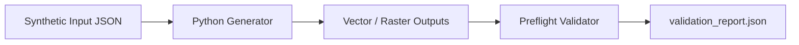
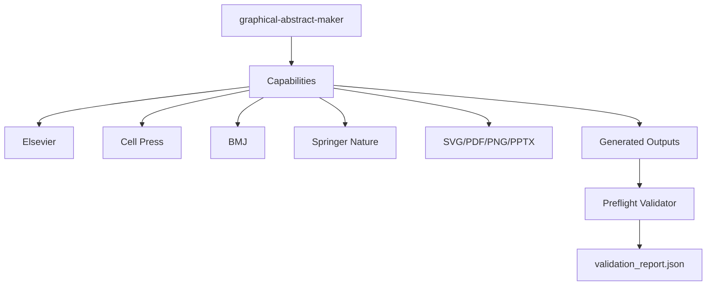

# `graphical-abstract-maker`


Portable Agent Skill for **Claude Code** and **Cline** that converts research papers and clinical trial results into journal-compliant **Graphical Abstracts** and **Visual Abstracts** (`SVG`, `PDF`, `300-DPI PNG`, and editable `PPTX`).

## Supported Journal Presets
- `elsevier-landscape` (`12.5 × 5.0 in` / `3750 × 1500 px` @ 300 DPI)
- `cell-press-square` (`10.0 × 10.0 in` / `3000 × 3000 px` @ 300 DPI, headerless 3-tier)
- `bmj-visual-abstract` (`16.0 × 9.0 in` / `4800 × 2700 px` clinical visual abstract)
- `springer-nature-compact` (`180 × 90 mm` double-column compact)

## Installation
- **Claude Code:** `.claude/skills/graphical-abstract-maker/` (or `~/.claude/skills/graphical-abstract-maker/`)
- **Cline:** `.cline/skills/graphical-abstract-maker/` (or `~/.cline/skills/graphical-abstract-maker/`)

## Quick Start
```bash
python scripts/generate_graphical_abstract.py --spec examples/fenofibrate_t1d_ga_spec.json --output-dir examples/output
python scripts/validate_graphical_abstract.py --output-dir examples/output --spec examples/fenofibrate_t1d_ga_spec.json
```

## Workflow



## Skill Aspects


