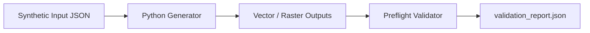
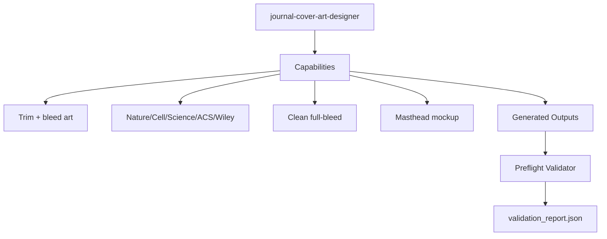

# `journal-cover-art-designer`

Portable Agent Skill for **Claude Code** and **Cline** that designs mathematical/vector scientific journal cover art formatted to exact publisher trim, bleed, and masthead safe-zone specifications (`Nature`, `Cell Press`, `Science`, `ACS/Wiley`), emitting both clean **unlettered full-bleed production art** and an **editorial masthead safe-zone mockup**.

## Workflow

## Skill Aspects

