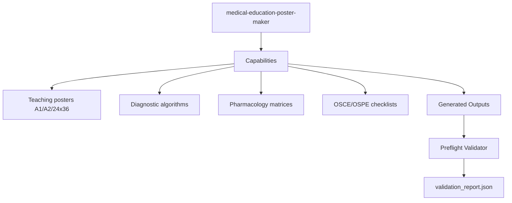

# `medical-education-poster-maker`

Portable Agent Skill for **Claude Code** and **Cline** that generates medical student and residency teaching posters (`A1`, `A2`, `24×36 in`) integrating physiology, branching diagnostic algorithms, pharmacology/pathology matrices, and OSCE/OSPE clinical examination guides.

## Workflow

## Skill Aspects

