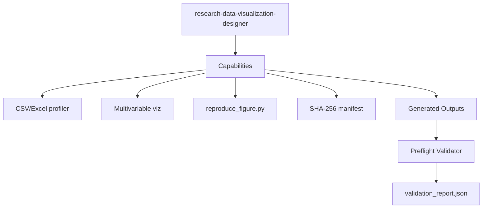

# `research-data-visualization-designer`

Portable Agent Skill for **Claude Code** and **Cline** that profiles CSV/Excel datasets, integrates R/Python/SPSS multivariable model outputs, produces publication-quality multi-panel statistical visualizations (`SVG`, `PDF`, `PNG`), and emits standalone `reproduce_figure.py` + `SHA-256` data provenance manifests.

## Workflow

## Skill Aspects

