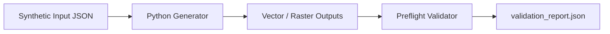
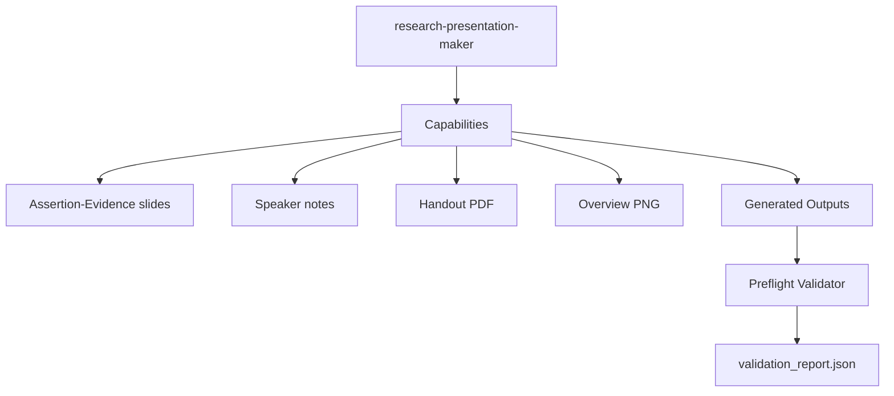

# `research-presentation-maker`

Portable Agent Skill for **Claude Code** and **Cline** that converts manuscripts and thesis chapters into **Assertion-Evidence** scientific presentations (`deck.pptx` with native speaker notes, vector `deck_handout.pdf`, `deck_overview.png`, and timed `speaker_notes.md`).

## Workflow

## Skill Aspects

