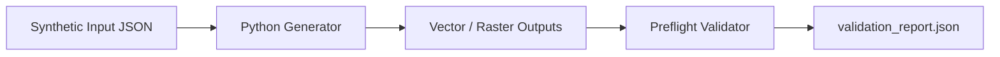
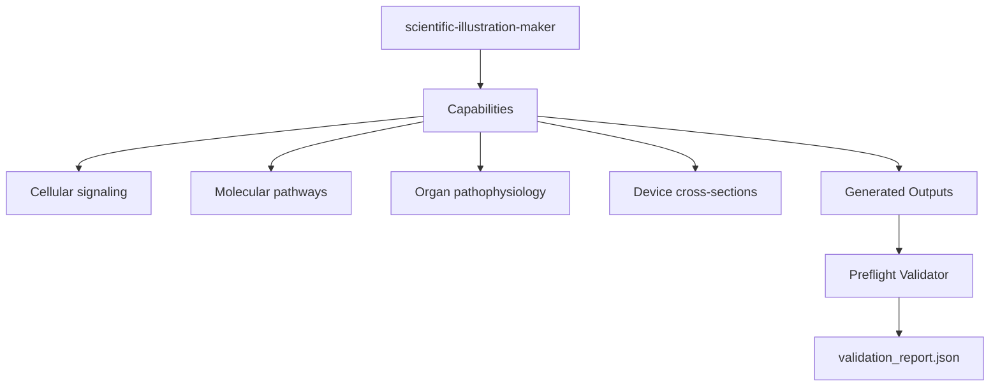

# `scientific-illustration-maker`

Portable Agent Skill for **Claude Code** and **Cline** that produces crisp 2D vector scientific illustrations and mechanism schematics (`cellular_signaling`, `molecular_pathway`, `organ_pathophysiology`, `medical_device`) in editable `SVG`, vector `PDF`, and high-DPI `PNG`.

## Workflow

## Skill Aspects

