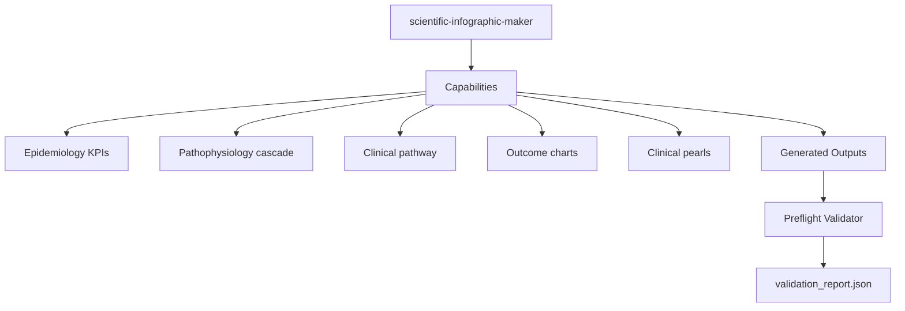

# `scientific-infographic-maker`

Portable Agent Skill for **Claude Code** and **Cline** that converts complex medical, public-health, and translational evidence into structured 4-band editorial infographics (`SVG`, vector `PDF`, `300-DPI PNG`, and editable `PPTX`).

## Capabilities
- Epidemiology & Disease Burden KPI strips
- Mechanism of Disease / Pathophysiology causal cascades
- Stepwise Clinical Pathways & Triage Protocols
- Zero-baseline quantitative outcome charts & medical education pearls

## Workflow

## Skill Aspects

